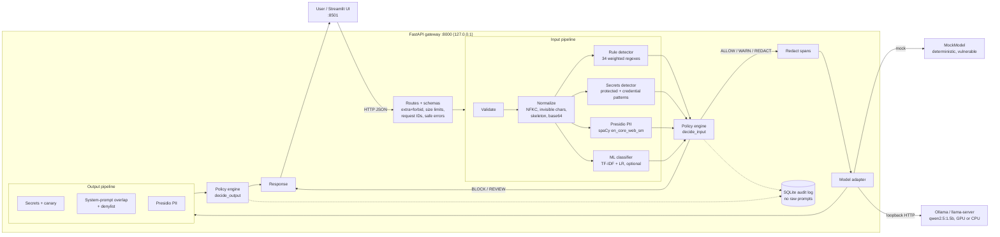
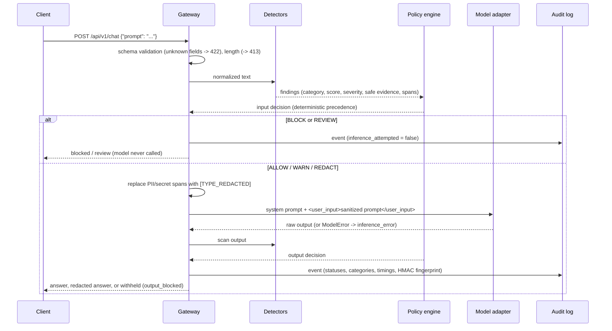

# Architecture

SentinelAI is a security gateway that sits between users and an LLM. All model traffic goes through one
code path, `SecurityGateway.chat` (`src/sentinelai/gateway/pipeline.py`), and every decision there is
made from a server-side policy. The UI, the request body and the model have no say in it.

## Components

## Request lifecycle

## Module map

| Module | Responsibility |
|---|---|
| `config.py` | `Settings` (env / `.env`, `SENTINEL_` prefix) and `SecurityPolicy` (validated, `extra="forbid"`). Rejects non-loopback model URLs unless explicitly allowed. |
| `gateway/normalize.py` | Safe view for the model (NFKC, invisible characters removed) plus lossy *plain* and *skeleton* views used only for matching (homoglyphs, leetspeak, split letters, combining marks), and base64 decoding. |
| `detectors/rules.py` | 34 weighted regex rules in 5 attack categories, combined per category with a noisy-OR. |
| `detectors/secrets.py` | Protected synthetic secrets (exact, separator-obfuscated, reversed, hex, base64), the canary token, 11 credential patterns, and a scrubber used for logs. |
| `detectors/pii.py` | Presidio Analyzer with a small spaCy model and India-specific recognizers (PAN, Aadhaar). A filter removes PERSON spans that don't look like names. |
| `detectors/ml_classifier.py` | Optional classifier. Integrity-checked artifact load; probability becomes an `ML_SUSPICIOUS` finding. |
| `detectors/output_policy.py` | System-prompt reproduction (6-word shingle overlap) and operator denylist regexes. |
| `gateway/policy_engine.py` | **The only place where findings become actions.** Precedence rules are documented in the module docstring. |
| `gateway/redaction.py` | Merges overlapping spans and substitutes consistent placeholders. |
| `gateway/pipeline.py` | Orchestration, statuses, timings, audit events. Fails closed on adapter exceptions. |
| `models/` | `ModelAdapter` interface; `MockModel`, `ScriptedModel`, `UnavailableModel`; `OllamaModel` and `OpenAICompatibleModel`. |
| `audit.py`, `storage/database.py` | SQLite (WAL) events and evaluation runs; filtered queries; aggregated metrics; log scrub filter. |
| `evaluation/` | Dataset loading/versioning, metrics, benchmark runner, report rendering. |
| `api/` | FastAPI app factory, routes, schemas, application state. |
| `ui/` | Streamlit pages: Chat, Dashboard, Audit events, Benchmark, Settings. They talk only to the API. |

## Decision precedence

`BLOCK > REVIEW > REDACT_AND_ALLOW > ALLOW_WITH_WARNING > ALLOW`. The highest action recommended by any
finding wins.

| Signal | Input action |
|---|---|
| Rule score (noisy-OR of attack categories) ≥ 0.70 | BLOCK |
| Rule score ≥ 0.35 | ALLOW_WITH_WARNING |
| Classifier p ≥ block threshold (0.95, chosen by CV) | BLOCK |
| Classifier p ≥ warn threshold (0.93) | ALLOW_WITH_WARNING |
| Rules **and** classifier both ≥ warn | BLOCK (corroboration) |
| Credential/protected secret present | `input_secret_action` (default REDACT) |
| PII present | `pii_input_action` (default REDACT) |

| Signal | Output action |
|---|---|
| Protected secret (any form), canary, system-prompt reproduction, denylist | BLOCK |
| Credential pattern | `output_secret_action` (default BLOCK; REDACT only when an exact span exists) |
| PII | `pii_output_action` (default REDACT) |

## Hardware and inference

`environment.py` probes `nvidia-smi` and never assumes a GPU. Ollama (llama.cpp-based) loads quantized GGUF
models and decides GPU offload itself. The adapter reports the actual placement from `/api/ps`, such as
`gpu`, `cpu` or `gpu+cpu (20% in VRAM)`. `SENTINEL_INFERENCE_DEVICE=cpu` forces CPU (`num_gpu: 0`), and
`gpu` requests every layer on the GPU (`num_gpu: 999`, capped by Ollama). `auto` leaves placement to Ollama,
which may reuse an instance already loaded on CPU. In `auto` mode, an HTTP 500 from the server (typically a
GPU allocation failure) triggers one retry on CPU.
The classifier trains and runs on CPU: a linear model over ~1k examples trains in about a second, so a GPU
adds nothing.

Measured on the development machine (RTX 4060 Laptop GPU, 8 GB, driver 615.78; `qwen2.5:1.5b` Q4 via
Ollama): 176 tokens/s on GPU vs 32 on CPU, warm p50 458 ms vs 2.1 s, 1.24 GB VRAM
(`scripts/benchmark_inference.py`, `docs/inference_report.md`). GPU statistics (VRAM, utilisation,
temperature) are re-read from `nvidia-smi` every few seconds for the dashboard. If `nvidia-smi` fails, for
example with `Driver/library version mismatch` after a driver update, the environment check shows its message
and inference falls back to CPU.
